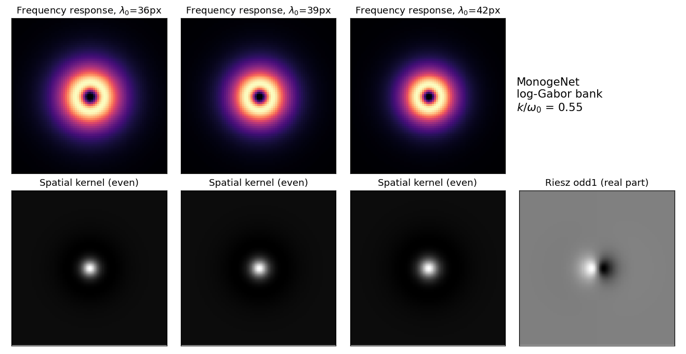

# MonogeNet

**Learnable monogenic signal layers for PyTorch.** Log-Gabor filters, phase symmetry, phase asymmetry and phase congruency as trainable CNN building blocks for medical imaging.

> Status: early development. See [ROADMAP.md](ROADMAP.md).



*Radial log-Gabor bank with the thesis defaults (wavelengths 36, 39, 42 px, k/w0 = 0.55): frequency responses, spatial kernels and a Riesz component. Regenerate with `python experiments/make_readme_figure.py`.*

## Motivation

Local phase features (phase symmetry, phase asymmetry, phase congruency) computed from the monogenic signal are contrast-invariant and work well on noisy modalities such as ultrasound, but their filter parameters are usually hand-tuned. MonogeNet makes them **learnable**, and explores using them **inside** a network (not only as a pre-processing step) as parameter-efficient replacements for convolutions.

This project continues the work in:

> E. de Avila-Armenta et al., *Femoral Head Surface Segmentation Using Ultrasound Images as Input Source: A Local Phase and Rigid Filtering Approach*, ARTIIS 2024 Workshops, CCIS 2348, pp. 267–281, Springer, 2025. https://doi.org/10.1007/978-3-031-83435-6_20

## Planned components

| Module | Contents |
|---|---|
| `monogenet.filters` | Differentiable log-Gabor filter bank, Riesz transform (`torch.fft`) |
| `monogenet.features` | Monogenic signal, learnable phase symmetry / asymmetry / congruency, feature type |
| `monogenet.layers` | `MonogenicFrontEnd` (entry layer), `PhaseBlock` (depthwise phase filtering + 1×1 mixing) |
| `monogenet.data` | MedMNIST+ loaders (BreastMNIST, OCTMNIST) |

## Benchmarks (planned)

- **BreastMNIST** (breast ultrasound, small-data regime) and **OCTMNIST** (retinal OCT, large-data regime) from MedMNIST+, at 128×128 and 224×224.
- Robustness to contrast and noise degradation with MedMNIST-C.

## Project layout

```
src/monogenet/   library code
tests/           unit tests (synthetic images with known answers)
experiments/     training and evaluation scripts
notebooks/       exploration and figures
docs/            notes and write-up
```
